# WhatsApp-style Chat for Android: Mobile System Design Reference

A working, offline-first Android messaging client (text, images, video) plus the design doc behind it.
It is built to prepare for **Mobile System Design interviews for Android Engineering Manager / Staff
roles** (Google, Uber, Amazon, Meta).

The backend is simulated **in-process** (`FakeChatServer`, `FakeMediaStore`), so the app runs on any
emulator with no infrastructure. The fake server still behaves like a real one in the ways that matter
for client design: it keeps an ordered event log with sequence numbers, dedupes sends idempotently,
replays missed events on reconnect, sends delivery/read receipts, sends typing events, and supports
resumable media transfer. If you replace the three fakes in `AppContainer` with real network clients,
nothing above the data layer changes. See [§1.2 Mock server](#12-the-mock-server).

Security is built in, not just described: the database is encrypted (SQLCipher with a Keystore-wrapped
key), downloaded media is integrity-checked, all network input is validated, and backups exclude
chats. Everything is listed with its trade-offs in [§16](#16-security--privacy-measures-and-trade-offs).

<p align="center">
  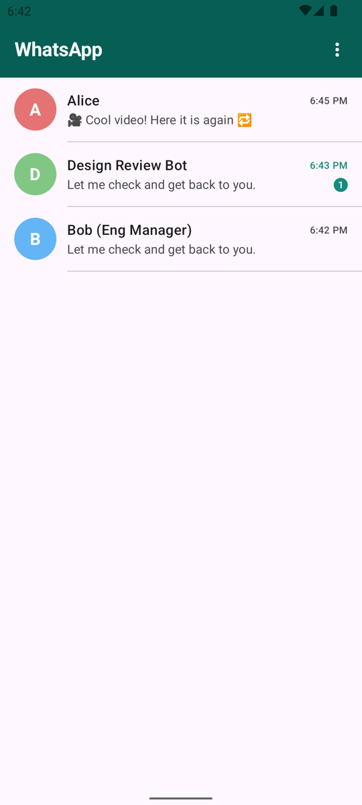
  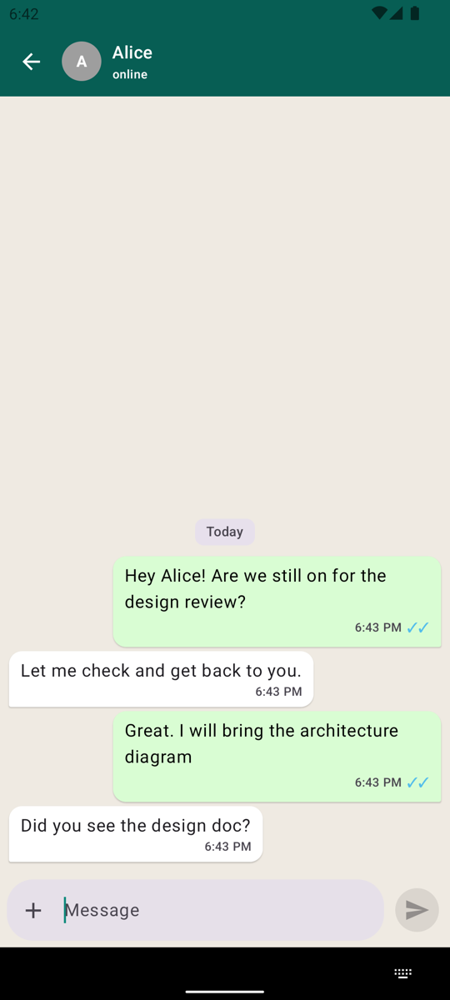
  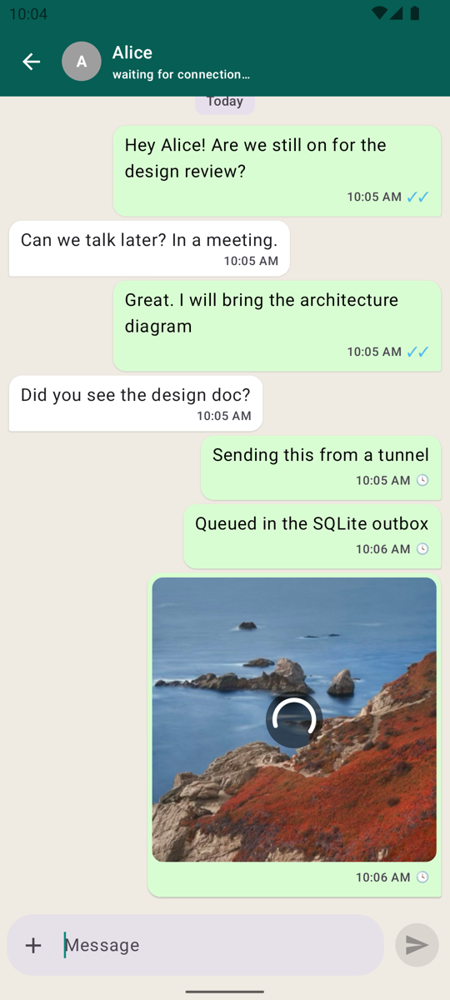
  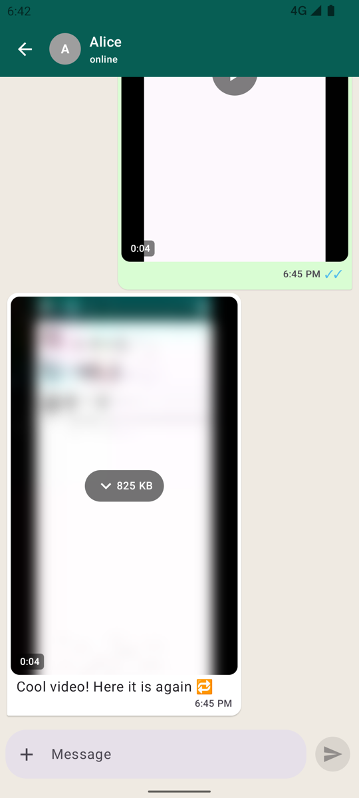
</p>

---

## Table of contents

1. [Run it & 2-minute demo script](#1-run-it--2-minute-demo-script) ·
   [Screenshots](#11-screenshots-captured-on-an-api-32-emulator) ·
   [Mock server](#12-the-mock-server) ·
   [Bugs found on device](#13-bugs-found-by-running-it-on-a-device-great-interview-stories)
2. [How to drive the interview (45–60 min)](#2-how-to-drive-the-interview-4560-min)
3. [Requirements](#3-requirements)
4. [Back-of-the-envelope numbers](#4-back-of-the-envelope-numbers)
5. [High-level architecture](#5-high-level-architecture)
6. [Client architecture](#6-client-architecture)
7. [Data model](#7-data-model)
8. [Protocol / API](#8-protocol--api)
9. [Key flows (sequence diagrams)](#9-key-flows)
10. [Deep dives & trade-offs](#10-deep-dives--trade-offs)
11. [Decision log (trade-off table)](#11-decision-log)
12. [The EM lens: delivery, team, rollout, metrics](#12-the-em-lens)
13. [Likely follow-up questions & crisp answers](#13-likely-follow-up-questions)
14. [What's real vs simulated; production gaps](#14-whats-real-vs-simulated)
15. [Project structure](#15-project-structure)
16. [**Security & privacy: every measure and its trade-off**](#16-security--privacy-measures-and-trade-offs)

---

## 1. Run it & 2-minute demo script

```bash
./gradlew :app:installDebug          # or Run ▶ in Android Studio
./gradlew :app:testDebugUnitTest     # JVM tests: server contract, backoff, status machine, image sizing
```

Stack: Kotlin 2.4, Jetpack Compose (Material 3), Room + Paging 3, WorkManager, Coroutines/Flow,
Media3 ExoPlayer, Coil 3, Navigation Compose. minSdk 24, targetSdk 37.

**Demo script (use this live if the interview allows a laptop, or describe it):**

| Step | What to do | What it demonstrates |
|---|---|---|
| 1 | Open *Alice* and send "hi" | Optimistic UI: the bubble appears instantly with 🕓, then ✓ (server ack), ✓✓ (delivered), blue ✓✓ (read). The header shows *typing…* and then a reply arrives. |
| 2 | ⋮ → **Simulate offline**, then send 3 messages | The outbox: messages persist as PENDING and the header says *waiting for connection…* |
| 3 | While offline, kill the app (swipe away) and reopen it | Durability: the queued messages are still there and send on launch, because the outbox is in SQLite, not in memory. (The *Simulate offline* toggle itself is in memory, so it resets to online on restart.) |
| 4 | Turn **Simulate offline** off | Reconnect with backoff, `Hello(lastSeq)`, the outbox drains, and the server dedupes. Receipts and replies that the server produced while you were offline are replayed in order. |
| 5 | Tap ➕ and pick a photo | Client-side compression, a micro-thumbnail, a WorkManager upload with a progress ring, and the message is sent only after the upload finishes. The bot echoes the photo back, so the receive path auto-downloads it. |
| 6 | Pick a video, go offline mid-upload, go back online | Resumable chunked upload continues from the last byte. Incoming videos follow the Wi-Fi-only auto-download policy, otherwise you get a tap-to-download button. |

On Android 13+ ➕ opens the system Photo Picker. On older versions the same API falls back to the
system document picker, so no storage permission is needed on any version.

### 1.1 Screenshots (captured on an API 32 emulator)

All screenshots below were taken from this app running against the in-process mock server.

**Text chat: optimistic send, receipts, typing**

| Chat list | Contact is typing | ✓ → ✓✓ → blue ✓✓, replies |
|---|---|---|
|  | 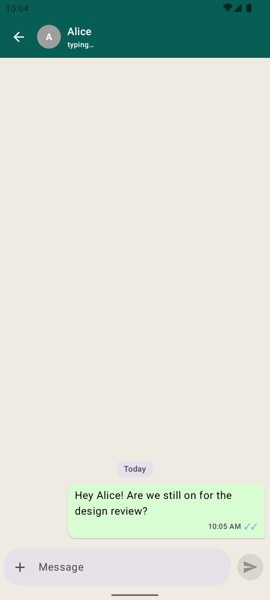 |  |
| Last-message preview (🎥 for video), unread badge. The *Design Review Bot* reply arrived after the chat was closed, so it stays unread (receipts are visibility-gated). | `TypingChanged` is an **ephemeral** frame. It's never stored in Room or replayed. | Status only moves forward (enforced in SQL). Day header comes from `insertSeparators`. |

**Offline-first: outbox, then reconnect and drain**

| Debug toggle | Offline: everything queued | List while offline | After reconnect |
|---|---|---|---|
| 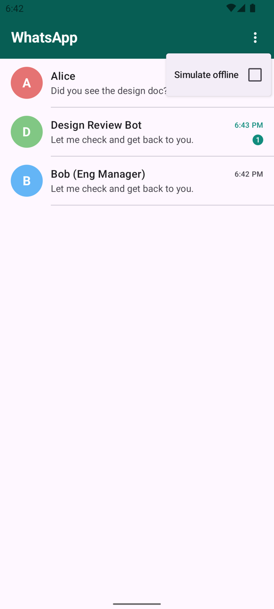 |  | 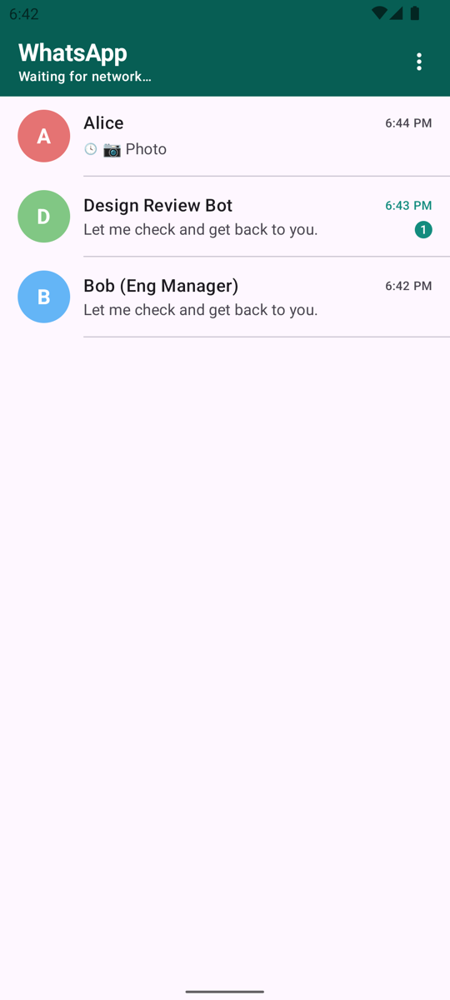 | 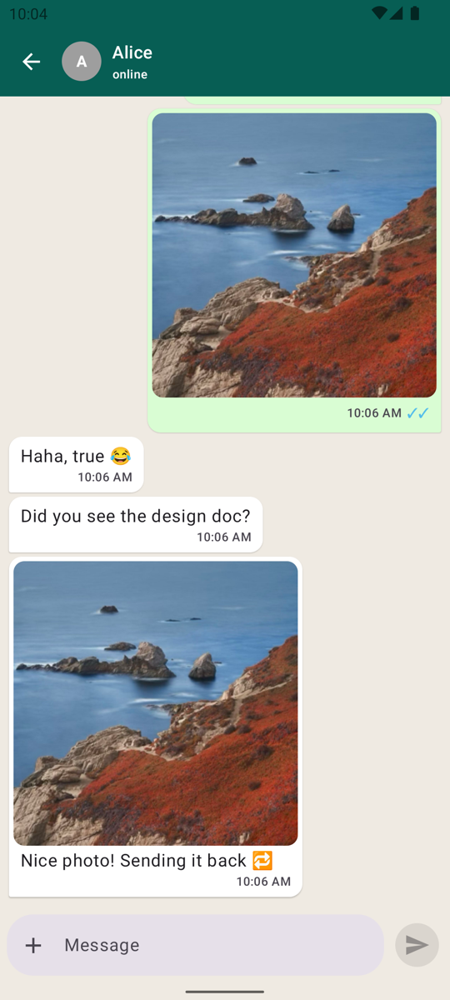 |
| ⋮ → *Simulate offline* cuts the transport and the "CDN". | Texts sit as 🕓 PENDING. The photo is compressed, stored locally, and waiting for upload (spinner). The header says *waiting for connection…* | `ConnectionManager` state reaches the UI as "Waiting for network…" | `Hello(lastSeq)` → replay → outbox drains → upload resumes → **photo sent only after the upload** → bot echoes it → auto-download. |

**Media: auto-download policy, download, viewers**

| Video on cellular | Downloading | Ready | Image viewer | Video (ExoPlayer) |
|---|---|---|---|---|
|  |  | 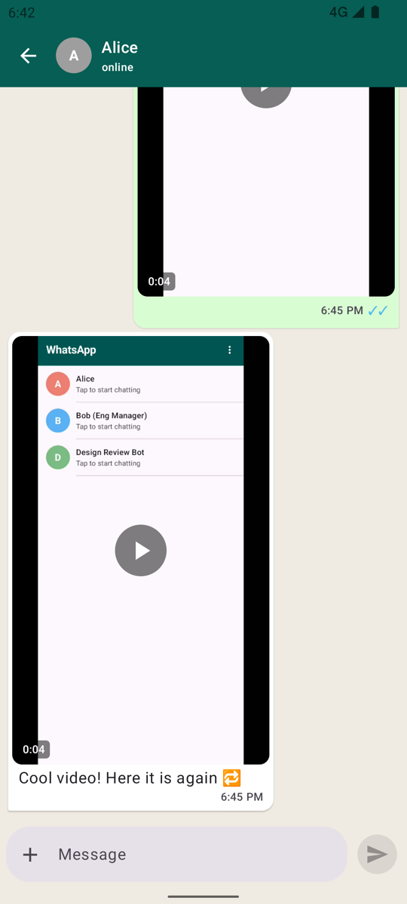 |  | 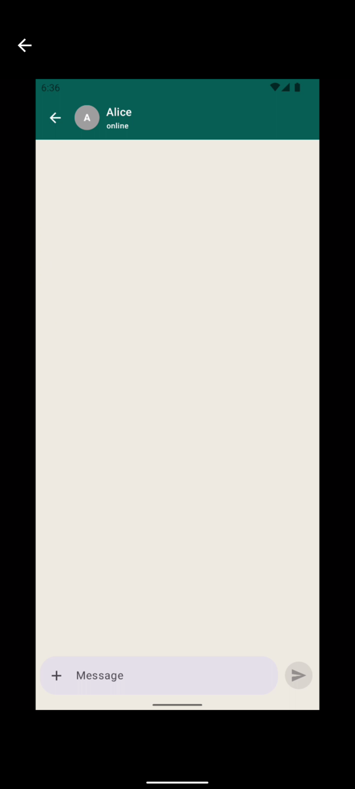 |
| On a **metered** network, video isn't auto-downloaded. The blurred **micro-thumbnail** that came inline with the message renders instantly, plus duration and a "⬇ 825 KB" button. | Resumable download worker. Progress comes from the in-memory tracker, not Room. | Local file. Frame rendered by Coil's video decoder. | Full-screen `AsyncImage`. | Player created per file and released in `onDispose`. |

Measured on the device: a 764 KB, 3000 px JPEG became **~185 KB** at 1600 px after the client-side
downscale and re-encode (about −75% upload bytes). Re-encoding also drops all EXIF data, including
any GPS location.

### 1.2 The mock server

There's no backend to deploy. Three fakes in `data/remote/fake/` stand in for it, behind the same
interfaces a real implementation would use:

| Fake | Replaces (production) | Behaviour it simulates faithfully |
|---|---|---|
| [`FakeChatServer`](app/src/main/java/com/example/whatsapp/data/remote/fake/FakeChatServer.kt) | Gateway + chat service + inbox log | **Idempotent sends** (same `clientMessageId` → same seq, processed once). **Per-user ordered event log** with monotonic `seq`. **Replay after cursor** on `Hello(lastSeq)` followed by `SyncComplete`. Events produced while you're offline are buffered. Contacts are **bots** that send DELIVERED, then READ, then *typing…*, then a reply, and echo your media back so the receive and download path gets exercised. Session IDs mean a stale disconnect can't kill a newer connection. |
| [`FakeChatTransport`](app/src/main/java/com/example/whatsapp/data/remote/fake/FakeChatTransport.kt) | OkHttp WebSocket | Handshake latency, per-frame latency, an abrupt socket drop when the network goes away, and `IOException` on send to a closed socket. |
| [`FakeMediaStore`](app/src/main/java/com/example/whatsapp/data/remote/fake/FakeMediaStore.kt) | CDN / object store (GCS/S3 resumable) | **Chunked, resumable** upload and download (resume from the bytes already persisted, the same contract as `Content-Range`/`Range`). Fails mid-transfer when offline. Blobs live in `filesDir/fake_cdn`, and URLs look like `fakecdn://<id>`. |

The server contract is unit-tested in
[`FakeChatServerTest`](app/src/test/java/com/example/whatsapp/FakeChatServerTest.kt): duplicate sends
are acked with the same seq and only one reply is produced; offline events are replayed in seq order
after the cursor; and a stale detach doesn't drop a newer session.

**Swapping in a real backend** touches only [`AppContainer`](app/src/main/java/com/example/whatsapp/di/AppContainer.kt):
implement `ChatTransport` with an OkHttp `WebSocketListener` (Protobuf frames) and `MediaStore` with
resumable HTTPS. `SyncEngine`, `ConnectionManager`, the DB, and all UI stay unchanged.

### 1.3 Bugs found by running it on a device (great interview stories)

Unit tests passed, and both of these still only showed up on a device. Telling either story in an
interview shows you validate in real conditions:

1. **Wi-Fi → cellular handover left the app "offline".** `NetworkMonitor` originally used
   `registerNetworkCallback`, which reports *every* network. When Wi-Fi dropped, `onLost` read
   `activeNetwork` before the system had promoted cellular, and the already-validated cellular
   network never fired again. **Fix:** `registerDefaultNetworkCallback`, which tracks only the
   network the system actually routes traffic over.
2. **A finished download sometimes kept showing its spinner** until the chat was reopened.
   Instrumentation showed the DB row was correct and that, in normal runs, a fresh PagingSource
   emitted it, so the stale frame was a timing race between a write and the PagingSource's
   invalidation registration. **Fix:** bubbles with an in-flight transfer also observe their own
   row through a single-row Room `Flow` (which registers before querying, so it can't miss the final
   write). The cost is bounded: only *visible* (lazy) bubbles with unsettled media subscribe, and
   settled messages cost nothing. See `MessageBubble`.
3. **Security bugs found the same way**: the encrypted-DB migration crashed on launch, and its error
   log leaked the encryption key into logcat. See [§16.5](#165-lessons-from-verifying-security-on-a-device).

---

## 2. How to drive the interview (45–60 min)

The interviewer is grading **structure, judgment, and communication**, not only knowledge. For an
EM role they also look for **scoping, risk management, and how you'd ship it with a team**.

| Time | Phase | What you say / draw |
|---|---|---|
| 0–5 | **Clarify & scope** | 1:1 only, or groups? Media types and size limits? E2EE required? Multi-device? Scale (DAU)? Offline expectations? Target markets (low-end devices, 2G)? |
| 5–10 | **Requirements + numbers** | Functional and non-functional lists (§3) and quick estimates (§4). State what you've left out of scope. |
| 10–20 | **High-level design** | Boxes: client ↔ gateway (WebSocket) ↔ chat service ↔ storage; media via CDN; push via FCM (§5). |
| 20–40 | **Client deep dive** (most of the grade) | Layers, SSOT, outbox, sync cursor, ordering, media pipeline, background work, pagination (§6–§10). |
| 40–50 | **Trade-offs, failure modes, scale** | "What happens if…" (§10, §13). |
| 50–60 | **EM lens** | Team split, milestones, rollout and flags, metrics and alerts, risks (§12). |

Phrases that signal seniority:
- "**The database is the single source of truth.** The UI never renders network responses directly."
- "Delivery is **at-least-once with idempotency keys**, which makes it **effectively-once**."
- "Order comes from a **server-assigned sequence**, never from device clocks."
- "I keep **ephemeral state** (typing, upload progress) **out of the database**."
- "Media is **out-of-band**: the chat channel carries a URL, a key, and a thumbnail, never the bytes."
- "I'd **measure** time-to-sent p95 and delivery success rate, and **gate the rollout** on them."

---

## 3. Requirements

### Functional (in scope)
- 1:1 chats with a conversation list (last message, time, unread badge)
- Send and receive **text, images, and videos**
- Message states: **pending → sent → delivered → read** (ticks)
- **Typing indicator** and online/connecting status
- **Offline**: read history, compose and send (queued), auto-send on reconnect
- Paginated history (thousands of messages per chat)
- Media: preview before download, progress, retry, full-screen viewer and video player

### Non-functional
| Requirement | Target / approach |
|---|---|
| Perceived send latency | **0 ms**: optimistic insert into the local DB |
| Server ack latency | p95 < 500 ms on 4G |
| Reliability | No lost or duplicated messages across crashes, kills, and network flaps |
| Ordering | Consistent per conversation across devices |
| Battery | No background socket; push wakes the app; work is batched by WorkManager |
| Data usage | Client-side compression; auto-download policy per network type |
| Low-end devices | Paged lists, bounded bitmap decode, small APK (R8) |
| Security | E2EE (Signal protocol) in production; TLS; EXIF stripped from photos |

### Out of scope (say this out loud)
Voice/video calls (WebRTC is a separate design), stories/status, payments, contact discovery,
backups, web/desktop companions. Each has a short note in §10 in case you're asked.

---

## 4. Back-of-the-envelope numbers

Round numbers only. The point is to show you can size things, not to be precise.

- **Users**: 500M DAU × 40 messages sent/day = **20B messages/day** ≈ **230K msgs/s average**, ~**700K/s peak** (3×).
- **Text size**: ~100 B payload + ~200 B metadata ≈ 300 B, so 20B × 300 B ≈ **6 TB/day** of text. Servers
  typically delete messages after delivery (WhatsApp model), so steady-state server storage stays small.
- **Media**: assume 10% of messages carry media at ~300 KB average after compression, giving 2B × 300 KB ≈
  **600 TB/day** of upload egress, which is why **client compression and CDN dedupe** are the big cost levers.
- **Connections**: ~100–200M concurrent sockets at peak. At ~1M connections per gateway host (Erlang/epoll-class),
  that's a few hundred gateway hosts.
- **On device**: a heavy user with 200K messages × ~500 B/row ≈ 100 MB of SQLite, which is fine with indices
  and paging. Media dominates storage, so you need a "Manage storage" screen.

What these numbers mean for the client: compression saves real money. Reconnect storms need backoff
with jitter. Device storage management is a real feature.

---

## 5. High-level architecture

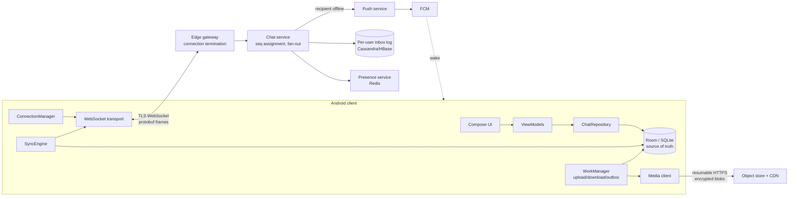

The backend, in one breath (useful context, though the interview is about the client):
- **Gateways** hold long-lived sockets and route by user ID through a session registry.
- **Chat service** assigns a **monotonic sequence number per recipient inbox**, persists the event, and
  forwards it to the recipient's gateway if they're online. Otherwise it triggers **push**.
- **Inbox log**: events stay until the client acks them via its cursor, then get trimmed.
- **Media** never touches the chat path. The client uploads encrypted bytes to blob storage and
  sends `{url, key, hash, thumb}` in the message.

---

## 6. Client architecture

```
┌──────────────────────────────── UI layer (Compose) ─────────────────────────────────┐
│ ChatListScreen   ChatScreen + MessageBubble   MediaViewerScreen                      │
│        ▲ StateFlow / PagingData (immutable UI state)        │ intents (send, retry)  │
├────────┴──────────────── ViewModels (screen state, no Android I/O) ───────────────────┤
│ ChatListViewModel   ChatViewModel (paging + day separators, read-receipt visibility)  │
├──────────────────────────────── Data layer ───────────────────────────────────────────┤
│ ChatRepository: UI-facing API. Writes to Room and returns immediately.                │
│   ├─ Room (AppDatabase): conversations, messages, sync_state   ◄── single source     │
│   ├─ SyncEngine: network frames → DB; DB outbox → network              of truth       │
│   ├─ ConnectionManager: ref-counted socket, backoff + jitter, network-aware           │
│   ├─ MediaProcessor: downscale/re-encode/EXIF-strip, micro-thumbnail                  │
│   ├─ TransferScheduler + Workers (WorkManager): upload, download, outbox flush         │
│   └─ TransferProgressTracker: in-memory progress (deliberately not in DB)             │
├──────────────────────────────── Remote (interfaces) ─────────────────────────────────┤
│ ChatTransport (WebSocket)   MediaStore (CDN)   ← fakes in this repo                   │
└───────────────────────────────────────────────────────────────────────────────────────┘
```

**Principles**
1. **Unidirectional data flow.** The UI renders state and emits intents. State flows down as
   `StateFlow`/`PagingData`, and events flow up as function calls.
2. **Single source of truth = Room.** The network only ever *writes to the DB*, and the UI only
   *reads the DB*. You get offline support, crash-safety, and instant UI with no extra work, and
   there's no "merge network and cache" logic in ViewModels.
3. **Writes are intents persisted first.** `sendText()` is a single INSERT. Everything after that
   (sending, retrying, acking) is asynchronous and driven by DB state. This is the
   **transactional outbox** pattern.
4. **Work that must outlive a screen** (media prep, uploads) runs in an app scope or WorkManager,
   never in `viewModelScope`.
5. **Interfaces at the network boundary** (`ChatTransport`, `MediaStore`), so the app runs and
   tests against fakes.

**DI**: manual (`AppContainer`) to keep this sample readable. In production I'd use **Hilt**
(scoping, `HiltWorkerFactory`, test overrides). It's a reasonable trade-off to mention.

**Modularization (production plan)**: `:app`, `:feature:chatlist`, `:feature:chat`,
`:feature:media-viewer`, `:core:data`, `:core:database`, `:core:network`, `:core:media`,
`:core:designsystem`, `:core:model`, `:core:testing`. Benefits: parallel builds, enforced
layering (features can't import `:core:network`), clear **team ownership** (CODEOWNERS per
module), and room for dynamic feature delivery later.

---

## 7. Data model

```sql
conversations(id PK, title, avatar_color, created_at)

messages(
  id TEXT PK,               -- client-generated UUID = idempotency key
  conversation_id FK → conversations ON DELETE CASCADE,
  sender_id, is_outgoing,
  type TEXT,                -- TEXT | IMAGE | VIDEO
  text,
  created_at,               -- ordering key (see §10.3)
  server_seq NULL,          -- set on ack / receive
  status INT,               -- -1 FAILED, 0 PENDING, 1 SENT, 2 DELIVERED, 3 READ
  media_local_path, media_remote_url, media_mime, media_width, media_height,
  media_duration_ms, media_size_bytes,
  media_micro_thumb BLOB,   -- ~1–3 KB JPEG
  transfer_state TEXT       -- NONE | UPLOAD_PENDING | UPLOADING | DOWNLOAD_AVAILABLE | DOWNLOADING | FAILED
)
INDEX (conversation_id, created_at)   -- chat screen paging
INDEX (is_outgoing, status)           -- outbox scan, unread counts

sync_state(id = 0, last_seq)          -- the sync cursor
```

**Design notes**
- **Status is an int so SQL enforces forward-only transitions**:
  `UPDATE … SET status = :s WHERE id = :id AND status >= 0 AND status < :s`.
  A late "DELIVERED" can never overwrite "READ". There's no read-modify-write race.
- **Delivery status and transfer state are separate dimensions.** A message can be
  `PENDING` + `UPLOADING`. Collapsing them into one enum causes state explosion.
- **The micro-thumbnail is stored inline** because it's tiny and makes the bubble render instantly
  with no I/O. Full media lives as **files**, not BLOBs, because large BLOBs bloat the DB and
  CursorWindow is limited to 2 MB.
- **The cursor is updated in the same transaction** as the event it covers, so a crash can never
  skip an event.
- **Conversation list = one query** with a correlated subquery for the last message and the unread
  count. At ~1K chats this is fine. At larger scale, **denormalize** `last_message_id` /
  `unread_count` onto `conversations` and update them in the same transaction (faster reads, more
  complex writes).
- **Schema export is on** (`app/schemas/`) so migrations can be reviewed and tested with
  `MigrationTestHelper`.
- Production additions: an **FTS4/FTS5 table** for message search, a **SQLCipher**-encrypted DB, and
  `reactions`, `receipts_outbox`, `groups/participants` tables.

---

## 8. Protocol / API

**Chat channel: persistent TLS WebSocket, Protobuf frames** (see `data/remote/Protocol.kt`)

| Direction | Frame | Notes |
|---|---|---|
| C→S | `Hello(lastSeq)` | First frame on every connection. The server replays everything after `lastSeq`, then sends `SyncComplete`. |
| C→S | `Send(clientMessageId, conversationId, type, text, media?)` | `clientMessageId` is the idempotency key. |
| C→S | `ReadReceipt(conversationId, messageIds)` | Batched. |
| S→C | `Ack(clientMessageId, seq, serverTs)` | Not sequenced. If it's lost, the client resends and the server re-acks with the same seq. |
| S→C | `NewMessage(seq, …)` / `StatusChanged(seq, id, status)` | **Sequenced**: persisted in the inbox log and replayable. |
| S→C | `TypingChanged(conversationId, isTyping)` | **Ephemeral**: never stored or replayed. |

**Media channel: HTTPS to the CDN/object store**
- `POST /uploads` → `{uploadId}`, then `PUT /uploads/{id}` with `Content-Range` chunks, and
  `HEAD /uploads/{id}` for **resume offset** (GCS/S3/tus-style resumable uploads).
- Downloads use `GET` with a `Range` header to resume.
- With E2EE the blob is **AES-256-CBC + HMAC encrypted on device**. The per-file key and
  SHA-256 travel inside the (E2E-encrypted) chat message, so the CDN only ever stores ciphertext.

**History / cold start** (not implemented): `GET /conversations/{id}/messages?before=<seq>&limit=50`
for keyset-paginated backfill on a new device. (WhatsApp proper doesn't keep server history and uses
backups instead. Messenger/Slack-style apps do keep it.)

**Why Protobuf**: compact (a big deal on 2G), schema evolution with field numbers, fast parsing.
JSON is fine for an MVP. Say so, then say why you'd move.

---

## 9. Key flows

### 9.1 Send a text (online)
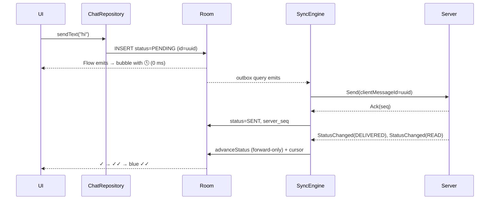

### 9.2 Offline → reconnect
1. While offline, the INSERT happens as usual and the outbox query emits, but the SyncEngine only
   drains while `ConnectionState == Connected`.
2. The network returns, so `ConnectionManager` connects (exponential backoff with full jitter on
   failures) and sends `Hello(lastSeq)`.
3. The server replays missed sequenced events. The client applies each one **and advances the
   cursor in one transaction**, and dedupes by message ID (`INSERT OR IGNORE`).
4. The `Connected` state restarts the outbox drain. All PENDING messages are (re)sent, and the
   server dedupes by `clientMessageId`.

### 9.3 Send media
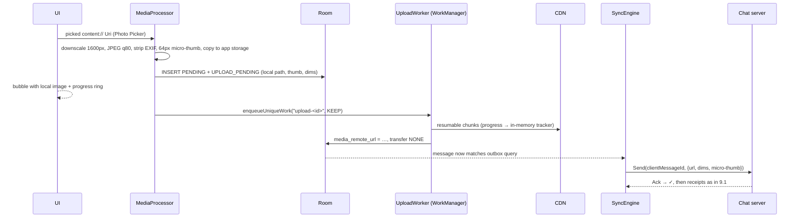
**Invariant:** a chat message is never sent before its media exists on the CDN, so the receiver
never sees a dangling URL. This is enforced by the outbox query
(`type = 'TEXT' OR media_remote_url IS NOT NULL`), not by sequencing code, so it holds across
crashes and retries.

### 9.4 Receive media
`NewMessage` with a media payload is inserted as `DOWNLOAD_AVAILABLE`, and the blurred micro-thumbnail
shows immediately. The auto-download policy decides: **images on any network, videos only on
unmetered** (WhatsApp defaults; make it user-configurable). Otherwise a ⬇ *1.2 MB* button
enqueues `MediaDownloadWorker` (resumable via `.part` + Range).

### 9.5 App in background / killed (production)
The socket is closed in the background. The server sends an **FCM high-priority data message**,
which wakes the app briefly. The app either (a) decrypts the payload in the push (WhatsApp-style,
small messages) or (b) treats the push as a **tickle**, fetching from the inbox log with an
expedited job. Then it posts a `MessagingStyle` notification with a direct-reply action. A reply
from the notification goes through the same `sendText()` → outbox → `OutboxWorker` path.

---

## 10. Deep dives & trade-offs

### 10.1 Real-time transport

| Option | Pros | Cons | Verdict |
|---|---|---|---|
| **WebSocket** | Full duplex, low overhead per frame, works through proxies (443), ubiquitous libs (OkHttp) | You build acks, QoS, and resume yourself | ✅ Chosen for the foreground |
| MQTT | Built-in QoS 0/1/2, tiny headers, designed for flaky mobile links (Messenger used it) | Broker infra; QoS semantics still don't give end-to-end app-level idempotency | Strong alternative; say you'd consider it |
| HTTP long-polling | Simple, works everywhere | Latency, a header on every poll, battery | Fallback only |
| SSE | Simple server→client | One-way; sends still need HTTP | No |
| **FCM only** | Zero battery cost from the app | Not real-time enough for an open chat, quotas, no delivery guarantee, ~4 KB payload limit | ✅ For background wake-ups only |
| gRPC bidi streaming | Typed, HTTP/2 multiplexing | Heavier on Android, proxy issues | Fine, but no clear win |

**Lifecycle (`ConnectionManager`)**: the socket is **ref-counted**. The foreground
(`ProcessLifecycleOwner`) holds it, and so does `OutboxWorker` while it's flushing. When no one
holds it, the socket closes and push takes over. The code `combine`s *wanted × network online* with
`collectLatest`, which gives automatic cancellation on network loss or backgrounding. Reconnect uses
**exponential backoff with full jitter** (prevents reconnect storms after an outage), and the backoff
resets on success. In production, add an **app-level heartbeat** (~every 30–60 s) because NAT/carrier
middleboxes silently drop idle TCP connections. Also track the **default network only** (I hit
exactly this bug while testing on the emulator: a Wi-Fi→cellular handover left the app "offline").

### 10.2 Delivery guarantees
- **At-least-once** from the client: everything un-acked is resent on every reconnect.
- **Idempotent server**: dedupes by `clientMessageId` and returns the *same* seq.
- **Idempotent client**: dedupes incoming by message ID (`INSERT OR IGNORE`), and status updates are
  forward-only.
- So: **effectively-once**, with no distributed transactions. *Exactly-once over a network
  doesn't exist; exactly-once **processing** via idempotency does.*
- In-flight tracking is reset per connection. In production, add an **ack timeout** (resend if no ack
  in N s on the same connection) and **max retries → FAILED + "tap to retry"** (the UI already handles
  FAILED).

### 10.3 Ordering
- **Device clocks are wrong** (skew, user-changed), so they're never used for cross-device order.
- The server assigns a **sequence per recipient inbox**, so events are applied in seq order and the
  cursor is a single number.
- Display order: incoming messages sort by server timestamp. **Own outgoing messages keep their local
  creation time**, so a bubble never jumps after the ack (WhatsApp does this too). The trade-off is
  that two people typing at once can see slightly different interleavings, which is acceptable for chat
  and is what every major messenger does.
- For strict per-conversation order (e.g. group chats, multi-device), use a **per-conversation seq**
  and **gap detection**: if you receive seq 105 and you have 103, fetch 104 before rendering beyond it.

### 10.4 Offline-first & the outbox
- The outbox is just a **query over the messages table**, so there's no separate queue to keep in sync.
- Survives process death. Text drains on reconnect, and media is driven by WorkManager.
- `OutboxWorker` is enqueued when the app goes to the background with unsent messages. It holds the
  connection until the outbox is empty, with a timeout and retry.
- Edits/deletes (production) would be new **commands** in the outbox (`EDIT id`, `DELETE id`),
  applied in order. Avoid mutate-in-place without versioning.

### 10.5 Local storage choice
| Option | Why / why not |
|---|---|
| **Room (SQLite)** ✅ | Relational queries (unread counts, last message), indices, transactions, Flow invalidation, Paging integration, migration tooling |
| SQLDelight | Great, and KMP-ready (pick it if sharing with iOS). Same SQLite underneath. |
| Realm | Object DB with live objects. Threading model and migration pain; smaller ecosystem now. |
| DataStore / files | Fine for prefs/cursor, not for queryable messages |

Encryption at rest: **SQLCipher** with a key from the Android **Keystore**. Search: **FTS5** virtual
table kept in sync via triggers. WAL is enabled so the UI reads while sync writes.

### 10.6 Chat list rendering & pagination
- **Paging 3 + Room `PagingSource`**, newest-first query with `LazyColumn(reverseLayout = true)`, so
  the list naturally sticks to the bottom and new messages appear at index 0.
- Day separators via `insertSeparators`. Stable `key` (message ID) and `contentType` per item enable
  Compose reuse and correct animations.
- **Auto-scroll only if the user is already at the bottom.** Never yank someone reading history.
- **Upload progress is kept in memory, not in Room.** Writing progress to `messages` would invalidate
  the `PagingSource` dozens of times per second and re-query the page. This is a strong point to make:
  it shows you understand how reactive DB invalidation costs.
- Room's PagingSource uses offset paging under the hood. For very large chats or jump-to-message
  (search results), implement a **keyset PagingSource** (`WHERE created_at < :anchor`) so you can
  start pages at an arbitrary anchor.
- Images are decoded **at display size** (Coil does this). Never decode a 12 MP bitmap for a 260 dp bubble.

### 10.7 Media pipeline
| Concern | This repo | Production |
|---|---|---|
| Picking | **Photo Picker** (`PickVisualMedia`), so no storage permission | Same; plus a camera capture via CameraX |
| Image compression | Downscale to 1600 px long edge (`inSampleSize` + scale), JPEG q80, EXIF rotation applied then **stripped** (privacy: GPS) | Same; consider WebP/AVIF; send HD as an option |
| Video | Size cap (64 MB) + copy | **Media3 Transformer**: H.264/HEVC 720p ~1.5 Mbps, typically 5–10× smaller |
| Preview | 64 px micro-thumb inline in the message, blurred | Same, or BlurHash (~30 bytes) |
| Upload | WorkManager, unique per message, network constraint, exponential backoff, **resumable chunks** | + `setForeground()` for long video uploads (10-minute worker limit), progress notification |
| Dedupe | n/a | **Content hash (SHA-256)**: forwarding a viral video re-uses the existing blob, so there's no re-upload (huge saving) |
| Encryption | n/a | AES-256 per-file key + HMAC; key and hash in the E2E message |
| Download | Auto policy (images always, video on Wi-Fi), tap-to-download, resumable | + user settings per network type, roaming = off |
| Storage | App-private `filesDir/media` (survives the content:// grant expiring) | + "Manage storage" UI, LRU eviction of *cached* media, optional "save to gallery" via MediaStore |

### 10.8 Background execution on modern Android
- **Doze / App Standby buckets** throttle jobs and network for backgrounded apps. A persistent
  background socket is not viable (and wastes battery).
- **WorkManager** for deferrable, guaranteed work (uploads, downloads, outbox), using constraints,
  backoff, and unique names for idempotent enqueueing.
- **Expedited work** for user-initiated, time-sensitive tasks (sending from a notification reply).
- **FCM high-priority** messages are the only reliable background wake-up. FCM can deprioritize them
  if they don't lead to a user-visible notification, so don't use high priority for silent syncs.
- **Foreground service** (`dataSync` type) only for long user-visible transfers. It requires a
  notification and Play policy justification.

### 10.9 Push notifications
- `MessagingStyle` notifications grouped per conversation, with **direct reply** and **mark as read**
  actions, plus conversation shortcuts so they appear in the conversation section.
- Update or cancel the notification when messages are read on another device (via a push or a sync event).
- With E2EE the server can't put plaintext in the push. Either encrypt the payload with session keys
  (decrypted on device), or send a content-free tickle and fetch.

### 10.10 Security & privacy (summary; full detail in [§16](#16-security--privacy-measures-and-trade-offs))
- **Signal protocol**: X3DH for the initial key agreement using prekeys uploaded to the server, then
  the **Double Ratchet** for forward secrecy and post-compromise security. Groups use **Sender Keys**
  (one encryption per message, not one per member).
- Private identity keys live in the **Android Keystore** (StrongBox when available).
- TLS everywhere, **certificate pinning** (with a backup pin and a kill switch), no PII in logs or
  analytics, `allowBackup` rules excluding keys, `FLAG_SECURE` as an option for sensitive screens.
- EXIF stripping (done here) and link-preview generation **on the sender's side**, so the server never
  sees URLs.

### 10.11 Groups (if asked)
- **Fan-out on write**: the server writes one event per member inbox. That's simple, reads are fast,
  and it's fine for ≤1–2K members (WhatsApp's cap is ~1K).
- With E2EE, sender keys make the client encrypt once. The server still fans out the ciphertext.
- Receipts in groups are aggregated per member (`delivered to 37/40`). Store them in a
  `receipts(message_id, user_id, status)` table, and only show blue ticks once all members have read.
- Very large channels need **fan-out on read** (pull-based), which is a different product.

### 10.12 Multi-device (if asked)
- Each device has its own identity key and inbox cursor. The sender encrypts to every device of the
  recipient (client-fanout), and also to its *own* other devices so they see sent messages.
- Read state syncs across devices via "self" events.

### 10.13 Performance & quality
- **Startup**: Baseline Profiles + Macrobenchmark for cold start; lazy init in `AppContainer`;
  App Startup library to order initializers.
- **Compose**: stable/immutable UI models, `key` + `contentType` in lazy lists, collect progress
  *only while transferring* (see `MessageBubble`), avoid recomposing whole rows on tick changes.
- **Memory**: bounded bitmap decode, Coil memory/disk caches, release ExoPlayer in `onDispose`.
- **Jank**: JankStats / FrameMetrics in production, profiling with Perfetto.

### 10.14 Out-of-scope features: one-liners
- **Voice/video calls**: WebRTC with STUN/TURN, a separate signaling channel (it can reuse the socket),
  ConnectionService/Telecom integration, and high-priority FCM for incoming calls.
- **Backups**: encrypted export to Google Drive with a user-held key.
- **Contact discovery**: hash phone numbers on device, private set intersection, rate limits.

---

## 11. Decision log

| Decision | Chosen | Alternatives | Why | Revisit when |
|---|---|---|---|---|
| Source of truth | Room DB | In-memory cache + network | Offline, crash-safe, single code path | Never for chat |
| Realtime | WebSocket (fg) + FCM (bg) | MQTT, long-poll, FCM-only | Duplex, low latency; push for battery | Measured reconnect cost on 2G is high → MQTT |
| Delivery | At-least-once + idempotency | Exactly-once protocol | Simple, robust, no distributed txn | — |
| Ordering | Server seq per inbox; local ts for own msgs | Device timestamps, vector clocks | Clocks lie; stable UI for own messages | Multi-device groups → per-conversation seq + gap fill |
| Outbox | Query over messages table | Separate queue table/WorkManager per msg | No dual-write consistency issues | Edits/deletes → explicit command outbox |
| Media transport | Out-of-band CDN, resumable | Inline over socket | Socket stays light, CDN scales, resumable | — |
| Media sends | Upload first, then send message | Send message first with placeholder | Receiver never gets a dangling URL | Want "sender sees upload on other device" UX |
| Transfer progress | In-memory | Persist in DB | Avoid PagingSource invalidation storms | Needs to survive process death → WorkManager `setProgress` |
| Background work | WorkManager | Foreground service, AlarmManager | OS-friendly, constraints, survives death | Long videos → add `setForeground` |
| DI | Manual container | Hilt, Koin | Readability for a sample | Any real team → Hilt |
| Pagination | Paging 3 (Room) | Manual LIMIT/OFFSET, load all | Built-in invalidation, memory bounded | Jump-to-message → custom keyset source |
| UI | Compose + UDF | Views/RecyclerView | Modern, less code, testable state | — |
| Image loading | Coil 3 | Glide | Kotlin/coroutines-first, Compose-native | — |
| Auto-download | Images always, video Wi-Fi | Always / never | Data cost vs UX (matches WhatsApp defaults) | Make user-configurable |
| DB at rest | SQLCipher + Keystore-wrapped key | Rely on Android file-based encryption only | Protects on rooted/compromised/unlocked devices and in backups, not just a locked phone | APK size or perf budget tight and threat model is "lost locked phone" only |
| Backups | Exclude chats/media/keys | OS auto-backup | Private comms; Keystore key isn't restorable anyway | Ship app-level E2E-encrypted backup |
| Network input | Strict allowlist validation, drop + advance cursor | Trust server | Peer/server may be hostile | Add "unsupported message, update app" placeholder for forward-compat |
| Media integrity | SHA-256 + size in message, verify after download | Trust CDN/TLS | CDN or MITM can't swap bytes; corrupted files never reach decoders | E2EE → also per-file AES key + HMAC |

---

## 12. The EM lens

This is what separates an EM answer from a senior-IC answer. Do it briefly, but always do it.

**Team topology (example: ~12 Android engineers)**
- *Messaging Core* (4): sync engine, transport, DB, push. Owns reliability SLOs.
- *Media* (3): capture, processing, transfer, viewer, storage management.
- *Chat Experience* (3): chat list, chat screen, composer, notifications UX.
- *Platform* (2): build/modularization, design system, performance (startup, jank), CI.
- Interfaces between teams are the module APIs (`ChatRepository`, `MediaStore`), and CODEOWNERS
  enforces them.

**Milestones**
1. **M0 (2 wks)**: protocol spec signed off with backend, fake server, and a thin vertical slice
   (text send/receive). This de-risks the contract early.
2. **M1**: offline outbox, resync, receipts, push notifications. **Dogfood internally.**
3. **M2**: images (compression, upload, auto-download policy).
4. **M3**: video (transcoding), storage management.
5. **M4**: E2EE (needs a security review), multi-device.

**Rollout & safety**
- Server-driven **feature flags** per capability (e.g. `media_upload_v2`), with **kill switches**
  for anything risky (new transport, new compression).
- Play **staged rollout** at 1% → 5% → 20% → 50% → 100%, gated on metrics below. Halt on
  regression.
- **Backward compatibility**: the protocol uses Protobuf field numbers. Old clients must tolerate
  unknown message types (render "Update app to view this message").
- **DB migrations** are tested in CI with exported schemas. Never ship a destructive migration.

**Metrics (define the SLOs)**
| Metric | Why |
|---|---|
| Message send success rate (sent within 1 min, among online users) | Core reliability, target 99.9%+ |
| Time-to-SENT p50/p95 (tap → ack) | Perceived speed |
| Time-to-DELIVERED p95 | End-to-end health incl. push |
| Duplicate/lost message reports (client dedupe counters) | Correctness canary |
| Reconnect rate / sessions per hour | Transport health, battery |
| Media upload failure rate, bytes saved by compression | Cost & UX |
| Crash-free sessions, ANR rate, cold start p50/p90 | Play vitals, store ranking |
| Battery & data usage per DAU | Emerging-market retention |

Tracing: tag all logs and spans with `clientMessageId` so one message can be followed client → gateway → recipient.

**Risk register (examples)**: carrier NATs killing sockets (heartbeat tuning), OEM battery
killers (dontkillmyapp.com-style issues: rely on FCM, test on top OEMs), DB corruption on low
storage (handle `SQLiteFullException`, warn the user), Play policy on foreground services.

**People angle**: pair a senior engineer on the sync engine with a mid-level engineer to spread
knowledge (bus factor). Write design docs for transport/protocol choices. Do blameless postmortems
for message-loss incidents.

---

## 13. Likely follow-up questions

**Q: The user sends a message and the app is killed immediately. What happens?**
The INSERT committed before the UI updated, so the message is in the outbox. On the next launch
(or via `OutboxWorker` if it was enqueued on background), it's sent. The server dedupes if the
first attempt actually reached it.

**Q: The ack is lost but the server got the message.**
The client resends on reconnect with the same `clientMessageId`. The server returns the original
seq without re-processing. There's no duplicate.

**Q: Receipts arrive out of order (READ before DELIVERED).**
Forward-only SQL update: DELIVERED after READ is a no-op.

**Q: The user was offline for 2 weeks.**
`Hello(lastSeq)` replays the backlog in pages. If the cursor is older than server retention, the server
answers "resync required" and the client does a full re-fetch per conversation (or messages are lost by
policy, as on WhatsApp after 30 days). Apply the backlog in batched transactions to avoid UI churn.

**Q: How do you avoid draining the battery?**
No background socket; FCM for wake-ups; WorkManager with constraints; batched receipts; heartbeats
only while in the foreground; compression reduces radio time.

**Q: A chat has 500K messages. Does it scroll smoothly?**
Paging loads ~50 at a time with an indexed query, and Compose lazy lists recycle with stable
keys/contentType. Images decode at display size. DB size stays reasonable because media lives in files.

**Q: How would you test this?**
- **Unit** (JVM): state machine, backoff, sizing, server contract (`FakeChatServerTest` covers
  idempotency, replay-after-cursor, stale-session safety).
- **Integration**: Room in-memory DB + `FakeChatTransport` to test `SyncEngine` end to end; Room
  `MigrationTestHelper`.
- **UI**: Compose tests on screens with fake state; screenshot tests (Roborazzi/Paparazzi).
- **Chaos**: the *Simulate offline* toggle, plus a fault-injecting transport (drop or duplicate
  frames at random) running in CI.
- **Performance**: Macrobenchmark for startup and chat scroll; Baseline Profiles.

**Q: Why not WorkManager for every text message?**
Scheduling latency (from hundreds of ms to seconds) and overhead. While the socket is live, direct
sends are faster. WorkManager is the *backstop* when the app is in the background.

**Q: Why not keep upload progress in the DB?**
Each write invalidates Room observers, including the PagingSource, so you'd re-query the visible page
30–60 times per second. Progress is ephemeral, so it belongs in memory. Only state transitions are persisted.

**Q: How do you ensure a message isn't sent before its photo is uploaded?**
It's a data invariant: the outbox query excludes media messages without `media_remote_url`. No
coordination code is needed, and it survives crashes.

**Q: What would you change for iOS / KMP?**
Move models, protocol, SyncEngine, and the DB (SQLDelight) into a KMP shared module, and keep UI and
platform media/background APIs native. The fakes become shared test fixtures.

---

## 14. What's real vs simulated

**Real (production-grade patterns)**: Room SSOT and schema, forward-only status SQL, outbox
query, sync cursor in the same transaction, idempotent insert, ref-counted connection lifecycle
with backoff + jitter, default-network monitoring, WorkManager uploads/downloads with unique work
and retries, resumable chunk logic, image downscale/EXIF/micro-thumbnail, Photo Picker, Paging 3
with separators, in-memory progress, visibility-gated read receipts, ExoPlayer viewer. **Security**: SQLCipher DB
encryption with a Keystore-wrapped key and an atomic plaintext→encrypted migration, wire validation,
path confinement, media SHA-256 integrity, backup exclusions, network security config, and opt-in
`FLAG_SECURE` (§16).

**Simulated**: the server (`FakeChatServer`), the WebSocket (`FakeChatTransport`), and the CDN
(`FakeMediaStore`), all in-process. The contacts are bots that echo media back so the receive path
gets exercised.

**Known gaps you should name before the interviewer does**: no E2EE (§16.4); no auth; no FCM/notifications; no
video transcoding; no ack-timeout resend on a live connection; read receipts are best-effort (they'd
need their own outbox); no groups/multi-device; no `setForeground` for big uploads; no message
search/edit/delete; manual DI; single module.

---

## 15. Project structure

```
app/src/main/java/com/example/whatsapp/
├── ChatApplication.kt            # wires container, starts sync, foreground socket hold, Coil video
├── MainActivity.kt
├── di/AppContainer.kt            # manual DI; swap fakes → real impls here only
├── domain/model/Models.kt        # Message, MessageStatus (state machine), Media, ConnectionState
├── data/
│   ├── ChatRepository.kt         # UI-facing API: writes to DB, returns immediately
│   ├── local/                    # Room: Entities, Daos (outbox query, forward-only status), AppDatabase
│   ├── remote/                   # Protocol frames, ChatTransport & MediaStore interfaces
│   │   └── fake/                 # FakeChatServer, FakeChatTransport, FakeMediaStore
│   ├── network/NetworkMonitor.kt # default-network tracking + "simulate offline"
│   ├── sync/                     # ConnectionManager, SyncEngine, BackoffPolicy, OutboxWorker
│   └── media/                    # MediaProcessor, ImageSizing, TransferScheduler, workers, progress
├── security/                     # WireValidation (+ path confinement, sha256), DatabaseKeyProvider, SecuritySettings
└── ui/
    ├── AppNavHost.kt
    ├── chatlist/                 # list + "Simulate offline" / "Screen security" toggles
    ├── chat/                     # paging, day headers, bubbles, ticks, composer, photo picker
    ├── media/                    # full-screen image, ExoPlayer video
    ├── common/                   # avatar, ticks, formatting
    └── theme/
app/src/test/…                    # FakeChatServerTest, SecurityTest, BackoffPolicyTest, MessageStatusTest, ImageSizingTest
app/src/main/res/xml/             # backup + data-extraction rules, network_security_config
app/schemas/                      # exported Room schema (migration review/testing)
docs/screenshots/                 # screenshots used in this README (captured from the running app)
```

---

## 16. Security & privacy: measures and trade-offs

> **Interview framing:** start from the threat model, defend in layers, and say what each control
> *costs*. A control without a stated trade-off sounds like a checklist, not engineering judgment.

### 16.1 Threat model

| # | Attacker | Example | Primary defences |
|---|---|---|---|
| T1 | Network attacker | Public Wi-Fi, hostile carrier, rogue CA | TLS, cleartext ban, cert pinning, E2EE, media hash |
| T2 | Curious or compromised server/CDN | Insider, breach, subpoena, swapped blobs | **E2EE** (§16.4); media SHA-256 (done) |
| T3 | Malicious peer | Crafted message ID, oversized or odd media, decoder exploits | Wire validation, path confinement, MIME allowlist, size limits, bounded decoding |
| T4 | Physical / local access | Lost phone, rooted device, forensic image, backup extraction | DB encryption, Keystore, backup exclusions, screen security, app lock |
| T5 | Other apps on the device | Exported components, overlays, clipboard, shared storage | No exported components, private storage, Photo Picker, OS overlay protections |
| T6 | Modified client / bots | Spam, scraping, account takeover | Server-side auth, rate limits, Play Integrity as a risk signal |

### 16.2 Implemented in this repo (and how each was verified)

| # | Measure | Where | Threat | Verified by |
|---|---|---|---|---|
| 1 | **DB encryption at rest**: SQLCipher (AES-256, per-page HMAC) | [`AppDatabase`](app/src/main/java/com/example/whatsapp/data/local/AppDatabase.kt) | T4 | On device: file header is random bytes, not `SQLite format 3`; the `sqlite3` CLI reports *"file is not a database"* |
| 2 | **Envelope key management**: a random 256-bit passphrase, stored only wrapped by a non-exportable **Android Keystore** AES-GCM key (StrongBox if available, else TEE) | [`DatabaseKeyProvider`](app/src/main/java/com/example/whatsapp/security/DatabaseKeyProvider.kt) | T4 | Cold restart unwraps it and reopens the DB, with no crash; the prefs file only holds ciphertext |
| 3 | **Atomic plaintext → encrypted migration** for existing installs (`sqlcipher_export` into a temp file, rename, then delete the plaintext; Room's 1→2 `AutoMigration` runs afterwards) | `AppDatabase.migrateLegacyPlaintext` | T4 | On device, using a seeded **v1 plaintext DB**: its message survived, the plaintext file was deleted, and the schema was upgraded |
| 4 | **Key-loss recovery**: if the Keystore key is gone (restore onto a new device, OEM reset), wipe and re-sync instead of crash-looping | `AppDatabase.create` | Availability | By construction; see the trade-off below |
| 5 | **Wire validation**: message IDs must be UUIDs; conversation/sender IDs must be slugs; MIME allowlist per type (no SVG etc.); limits on size, dimensions, thumbnail and text; media must carry a SHA-256 | [`WireValidation`](app/src/main/java/com/example/whatsapp/security/WireValidation.kt), `SyncEngine` | T2, T3 | [`SecurityTest`](app/src/test/java/com/example/whatsapp/SecurityTest.kt) (traversal IDs, `image/svg+xml`, oversized payloads, missing hash) |
| 6 | **Path confinement**: every network-derived file name goes through `childSafely()` (canonical path must stay inside the directory); extensions are never derived from MIME strings | Download worker, `MediaProcessor`, `FakeMediaStore` | T3 | Unit tests: `../escape.jpg`, `../../etc/passwd`, `sub/dir.jpg`, `..` are all rejected |
| 7 | **Poison-frame isolation**: a malformed frame is dropped (and the cursor advanced so it isn't replayed forever) without killing the sync loop | `SyncEngine.start/apply` | T2, T3 (DoS) | Code path covered by the validation tests |
| 8 | **Media integrity**: the sender computes SHA-256 and the size and puts them in the message; the receiver verifies after downloading, and on a mismatch deletes the file, marks it FAILED and offers retry | `MediaProcessor`, `MediaDownloadWorker` | T1, T2 | On device: I **tampered with the CDN blob** (appended bytes) and the download was rejected, with no file kept and the blurred thumbnail plus a retry button shown ([screenshot](docs/screenshots/13_tampered_media_rejected.png)) |
| 9 | **Backups exclude** the DB, media, CDN cache and the wrapped key, for both cloud backup and device-to-device transfer (API 31+ and legacy rules) | [`data_extraction_rules.xml`](app/src/main/res/xml/data_extraction_rules.xml), [`backup_rules.xml`](app/src/main/res/xml/backup_rules.xml) | T4 | Config review |
| 10 | **Network security config**: cleartext banned, system CAs only; user CAs allowed **only in debug** (for proxy debugging); pinning template with a backup pin and an expiry | [`network_security_config.xml`](app/src/main/res/xml/network_security_config.xml) | T1 | Config review (the backend is in-process, so pins aren't active) |
| 11 | **EXIF stripping** (GPS, device model) by re-encoding outgoing photos | `MediaProcessor` | Privacy | On device: the source JPEG had an EXIF block, the sent file has none |
| 12 | **Opt-in screen security**: `FLAG_SECURE` (blocks screenshots, screen recording and casting) plus a blank Recents thumbnail on API 33+, applied before the first frame | [`SecuritySettings`](app/src/main/java/com/example/whatsapp/security/SecuritySettings.kt), `MainActivity`, ⋮ menu | T4, shoulder-surfing | On device: `screencap` returned **0 bytes** when on and a normal screenshot when off |
| 13 | **Minimal permissions**: only `INTERNET` and `ACCESS_NETWORK_STATE`; media through the **Photo Picker** (no storage permission) | Manifest, `ChatScreen` | T5 | Manifest review |
| 14 | **No exported components** except the launcher activity; WorkManager workers aren't exported | Manifest | T5 | Manifest review |
| 15 | **SQL injection impossible by construction**: Room binds every parameter; the one raw statement (the migration `ATTACH`) uses bound parameters | DAOs, `AppDatabase` | T3 | Code review |
| 16 | **Log hygiene**: no IDs, content or keys in logs (`SyncEngine` logs reasons only) | `SyncEngine`, `AppDatabase` | T4, T5 | On device: grepped logcat for key material and found 0 matches (see §16.5 for the leak this caught) |
| 17 | **Bounded decoding**: `inSampleSize` + downscaling caps bitmap memory, which defuses decompression bombs | `MediaProcessor`, `ImageSizing` | T3 | `ImageSizingTest` |
| 18 | **R8** shrinking and optimization for release | `app/build.gradle.kts` | Reverse engineering (a speed bump only) | Build config |

### 16.3 Trade-offs of what's implemented

| Decision | Cost / downside | Why it's still right here / alternative |
|---|---|---|
| **SQLCipher** on top of Android's file-based encryption (FBE) | Measured: +2.0 MB native library on arm64 (7.3 MB uncompressed across 4 ABIs in a universal APK; Play's per-ABI splits ship only one), ~5–15% slower queries, a slower first open (key derivation) | FBE only protects a **locked or powered-off** device. SQLCipher also covers root, sandbox escape, forensic images and backup extraction on an unlocked device. If the threat model is "lost locked phone", FBE alone is defensible and many apps stop there; say that explicitly |
| **Keystore-bound key, not exportable** | Losing the key means losing the local history (restore to a new phone, factory reset, rare OEM Keystore bugs) | Recover by **wiping and re-syncing** (done) plus an app-level E2EE backup (roadmap). Exportable keys would defeat the purpose |
| Key **not** tied to user authentication (`setUserAuthenticationRequired` is off) | A thief with an *unlocked* phone can open the app | Background sync and notifications must read the DB while the screen is locked. Offer an opt-in **biometric app lock** instead (roadmap) |
| Key unwrapped **at startup on the main thread** | Adds a Keystore round-trip (~10–50 ms) to cold start | Simple and deterministic. In production, open the DB lazily off the main thread and measure with Macrobenchmark |
| **Excluding chats from backups** | Switching phones loses history unless you build your own backup | Private messages shouldn't silently land in a cloud account, and a restored DB is unreadable anyway (measure 2). Ship E2E-encrypted backups with a user-held key |
| **Strict allowlist validation** (drop unknown MIME types etc.) | **Forward-compatibility risk**: a newer server sending `image/avif` would have its messages dropped by old clients, silently for now | Safety first. Production should render "This message isn't supported, update the app" instead of dropping it, and negotiate capabilities in `Hello` |
| **Advance the cursor past poison frames** | One bad event is skipped rather than retried | Blocking the cursor would stall *all* sync forever (self-inflicted DoS). Production should also emit telemetry so the server-side bug gets fixed |
| **Hash verification** of every download | One extra full read of the file (CPU and battery, roughly ms per MB) | Cheap compared with the download itself. With E2EE the HMAC check makes this mandatory anyway |
| **FLAG_SECURE opt-in** rather than forced | The default leaves screenshots possible | Forcing it hurts legitimate uses (sharing, reporting abuse, accessibility, screen readers on some OEMs) and can't stop a second camera. Signal uses the same opt-in model; WhatsApp forces it only for view-once media |
| **Debug builds trust user CAs** | A debug build on a compromised device could be MITM'd | Essential for proxy debugging; release builds can't do it (`debug-overrides`) |
| **Pinning not enabled** | Nothing is pinned right now | Pinning can **brick every installed client** if keys rotate unexpectedly. It needs backup pins, an expiry, and ideally a remote kill switch. Turn it on once the backend's key rotation process is owned |

### 16.4 Not implemented: production roadmap, with trade-offs

| Measure | What it would take | Trade-off to mention |
|---|---|---|
| **End-to-end encryption** (Signal protocol: X3DH + Double Ratchet; **Sender Keys** for groups; safety numbers) | libsignal, a prekey server, a sessions/identity store in the encrypted DB, key-change UX | The server can no longer **search, moderate, scan for spam or abuse, or preview links**, and push payloads must be encrypted. Multi-device and backups get much harder. It's the single biggest architectural decision, so plan it as its own milestone with an external audit |
| **Media encryption** (per-file AES-256-CBC + HMAC-SHA256 key, sent inside the E2E message) | Encrypt before upload, decrypt after verifying the hash | The CDN can't dedupe identical media across users (WhatsApp keeps dedupe on forwards by reusing the same key). Decrypting also costs CPU, and seeking in video gets harder |
| **Authentication** (phone OTP, registration-lock PIN, device-bound short-lived tokens with refresh rotation; wipe on logout) | Auth service, Keystore-backed token storage (Tink with DataStore; `security-crypto` is deprecated) | SMS OTP is vulnerable to SIM swap, so add a registration lock. Shorter token lifetimes add more refresh traffic |
| **Certificate pinning** (SPKI pins plus a backup, expiry, remote kill switch) | Uncomment the `network_security_config` pin-set | Risk of bricking clients (above) |
| **Play Integrity API** | Server verifies a token on register and on sensitive calls | False positives on custom ROMs. Use it as a **risk signal** (rate limits, extra checks), never a hard block |
| **Biometric app lock** | `BiometricPrompt` and an auth-bound key for the UI | Extra friction, and notifications must then hide content |
| **Notification privacy** | `VISIBILITY_PRIVATE` with a redacted public version; never put message text in the push payload | A less informative lock screen |
| **Encrypt media files at rest** | Tink streaming AEAD over `files/media` | Seeking in video and the CPU cost of thumbnail generation. FBE already covers the locked-device case |
| **Disappearing / view-once messages** | Timers in the DB plus deletion, and forced `FLAG_SECURE` for view-once | Be honest: flash wear-levelling and the recipient's camera mean deletion is **best effort**, not a guarantee |
| **Abuse resistance** | Server-side rate limits, block/report, spam heuristics on metadata | With E2EE these work on **metadata and user reports**, not content |
| **Supply chain** | Gradle `verification-metadata.xml`, Renovate/Dependabot, SBOM, reviewing SDKs that touch message data | Verification metadata adds friction to every dependency bump |
| **Hardening extras** | `EXTRA_IS_SENSITIVE` for copied OTPs/keys (API 33+), `filterTouchesWhenObscured` on confirm dialogs, a lint rule that bans logging message fields | Small costs; Android 12+ already blocks touches from untrusted overlays |
| **Root / tamper detection** | Integrity signals | Easily bypassed and causes false positives. Use it only as a risk signal |

### 16.5 Lessons from verifying security on a device

These are worth telling in an interview because they show that security code also needs real-device testing:

1. **`ATTACH` inherits the main connection's open flags.** The plaintext DB was opened `READWRITE`
   without `CREATE`, so SQLCipher couldn't create the encrypted target and the app crashed on
   launch. Unit tests can't catch this because it needs the native library.
2. **The error log printed the encryption key.** When that statement failed, SQLite's error log
   printed the full `ATTACH … KEY '<passphrase>'` text to logcat. The fix was to pass the path and
   key as **bound parameters** and to re-verify with a logcat grep (0 matches). General rule:
   secrets never go into SQL text, exception messages, or analytics.
3. **An empty target file would have caused data loss.** A stray 0-byte `chat_secure.db` would have
   made the migration think it was already done and delete the plaintext DB. It now treats an empty
   target as "not migrated", and exports to a temp file followed by an atomic rename.

### 16.6 Talk track (60 seconds)

> "I start with the threat model: network, server, malicious peer, physical access, other apps,
> modified clients. Transport is TLS with cleartext banned; pinning needs backup pins, an expiry and
> a kill switch because it can brick clients. Everything off the wire is validated against
> allowlists, and file paths are confined, because a message ID is attacker input. Media carries a
> SHA-256 that the receiver verifies, so a CDN can't swap content. At rest, the DB is SQLCipher
> with a Keystore-wrapped key, which covers more than file-based encryption does (rooted devices,
> backups), at a cost of a few MB and some query overhead. Backups exclude chats until we ship
> E2E-encrypted backups. The big roadmap item is **E2EE with the Signal protocol**: it removes the
> server from the trust base, but we give up server-side search, moderation and link previews, and
> multi-device gets hard. That's a product decision, not just an engineering one."
